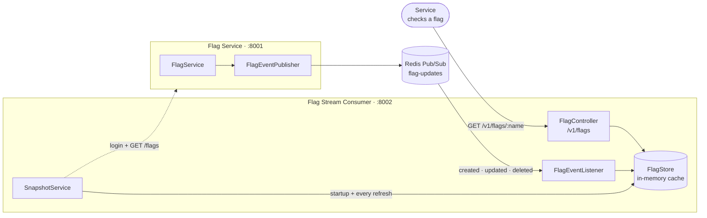

# Flag Stream Consumer

A lightweight downstream service for the Flag Service. It subscribes to the
`flag-updates` Redis Pub/Sub channel, keeps the flags it sees in memory, and
serves them over a small read-only HTTP API so your services can evaluate flags
locally instead of calling the Flag Service on every request.

**Stack:** Spring Boot 3.2 · Java 21 · Spring Data Redis (Lettuce) · Maven

---

                      ┌──────────────────────────────┐
                      │            UI                │
                      │  flag dashboard / toggle     │
                      └───────┬──────────────┬───────┘
             reads flags      │              │   writes flags
        GET /v1/flags         │              │   PATCH /flags/{id}
                              ▼              ▼
              ┌───────────────────┐   ┌────────────────────┐
              │ Flag Stream       │   │ Flag Service       │
              │ Consumer :8002    │   │ :8001              │
              │                   │   │                    │
              │ in-memory cache   │   │ auth + flag CRUD   │
              │ version/tombstone │   │ publisher          │
              └─────┬───────▲─────┘   └───┬────────────▲───┘
                    │       │             │            │
       SUBSCRIBE    │       │  GET /flags │            │ read/write
       (push)       │       └─────────────┘            │
                    ▼                    ┌─────────────▼─────┐
              ┌───────────┐              │  MongoDB Atlas    │
              │  Redis    │◄─PUBLISH─────┤  tenants/users/   │
              │  Pub/Sub  │              │  flags            │
              └───────────┘              └───────────────────┘

## Overview

|               |                                                                 |
| ------------- | --------------------------------------------------------------- |
| **Port**      | `8002`                                                          |
| **Input**     | Redis channel `flag-updates` (published by the Flag Service)    |
| **State**     | In-memory, per instance — no database                           |
| **Output**    | `GET /v1/flags`, `GET /v1/flags/{name}`, `GET /health`          |
| **Footprint** | One Spring Boot module, one runtime dependency beyond the JDK   |

The consumer is a **read-only replica**: flags are written through the Flag
Service and reach this process as events. It never writes back.

---

## Architecture



---

## Event handling

Every event on the channel is applied with two rules:

| Situation                                             | Behaviour                               |
| ----------------------------------------------------- | --------------------------------------- |
| `version` is newer than the cached one                | Apply (`created` / `updated` / `deleted`) |
| `version` is equal or older                           | Ignore as stale — out-of-order safe     |
| `deleted`                                             | Tombstone kept, flag hidden from reads  |
| Event for another tenant (with `FLAGS_TENANT_ID` set) | Discard                                 |
| Unparseable or incomplete payload                     | Discard, count it, log a warning        |

Deletions are stored as tombstones (`value: null`) instead of being erased, so
the version high-water mark survives and a delayed `created` cannot resurrect a
deleted flag. Tombstones are intentionally never swept.

### Event contract

```json
{
  "tenantId": "66f0acme",
  "name": "checkout-v2",
  "value": true,
  "version": 4,
  "ts": "2026-10-18T12:34:56.789Z",
  "event": "updated"
}
```

`event` is `created`, `updated`, or `deleted`; deletions carry `"value": null`.

### Why the snapshot sync exists

Redis Pub/Sub has no replay. A consumer that is restarted, or offline for a
moment, has gaps the stream can never fill — so the consumer also logs in with
a service account and reads `GET /flags`:

- once on startup,
- every `FLAGS_SNAPSHOT_REFRESH_MS` (default 5 minutes).

Snapshot entries are merged with a version check, so events that arrive while
the request is in flight are never overwritten by older data. Tombstones and
mid-flight events are preserved. Without `FLAGS_SERVICE_URL` the consumer still
works, but it only knows about flags that changed since it started.

Each refresh logs in again rather than caching a JWT. That is one extra request
every few minutes and removes all expiry bookkeeping.

### Redis is not a startup dependency

`RedisMessageListenerContainer.start()` connects synchronously, and a failure
would abort the Spring context. The container is therefore owned by
`FlagSubscription` and started after `ApplicationReadyEvent`. If Redis is
unreachable, the API and snapshot sync still come up, `/health` reports
`degraded`, and the subscription is retried every 5 seconds until it attaches.
After that, the container handles its own reconnects.

---

## API

| Method | Path               | Purpose                                        |
| ------ | ------------------ | ---------------------------------------------- |
| `GET`  | `/health`          | Redis state, cache size, event counters        |
| `GET`  | `/v1/flags`        | All live flags for a tenant                    |
| `GET`  | `/v1/flags/{name}` | One flag (boolean value, version, timestamp)   |

The tenant is taken from `?tenantId=`, then the `X-Tenant-Id` header, then
`FLAGS_TENANT_ID`. If none is available the request fails with `400`.

```bash
curl 'http://localhost:8002/v1/flags?tenantId=66f0acme'
```

```json
{
  "tenantId": "66f0acme",
  "count": 2,
  "flags": [
    { "name": "checkout-v2", "value": true, "version": 4, "ts": "2026-10-18T12:34:56.789Z" },
    { "name": "search-v2", "value": false, "version": 1, "ts": "2026-10-18T12:00:00.000Z" }
  ]
}
```

```bash
curl 'http://localhost:8002/v1/flags/checkout-v2?tenantId=66f0acme'
# 200  {"tenantId":"66f0acme","name":"checkout-v2","value":true,"version":4,"ts":"..."}
# 404  {"error":"flag_not_found","message":"No flag named 'checkout-v2' for tenant '66f0acme'"}
```

```bash
curl 'http://localhost:8002/health'
```

```json
{
  "status": "ok",
  "redis": "ready",
  "channel": "flag-updates",
  "tenantId": "66f0acme",
  "tenants": 1,
  "flags": 2,
  "events": { "applied": 3, "stale": 0, "ignored": 0 },
  "lastEventAt": "2026-10-18T12:34:57.001Z",
  "snapshot": { "enabled": true, "ok": true, "flags": 2, "at": "2026-10-18T12:35:00Z", "error": null },
  "uptimeSeconds": 42
}
```

`/health` always returns `200`; `status` flips to `degraded` when the
subscription is not attached, while the last known flags remain readable.

---

## Run

```bash
./mvnw spring-boot:run

# or build once and run the jar
./mvnw package
java -jar target/flag-stream-consumer-0.0.1-SNAPSHOT.jar

./mvnw test
```

Java 21+ is required. The service starts with no configuration at all and looks
for Redis on `localhost:6379`.

### Configuration

| Variable                    | Default                  | Meaning                                               |
| --------------------------- | ------------------------ | ----------------------------------------------------- |
| `SERVER_PORT` / `PORT`      | `8002`                   | HTTP listen port                                      |
| `SPRING_DATA_REDIS_URL`     | `redis://localhost:6379` | Redis carrying `flag-updates` (`rediss://` for TLS)   |
| `REDIS_URL`                 | `redis://localhost:6379` | Alias for the above; `SPRING_DATA_REDIS_URL` wins     |
| `FLAG_CHANNEL`              | `flag-updates`           | Channel to subscribe to                               |
| `FLAGS_TENANT_ID`           | —                        | Lock to one tenant; default for the HTTP API          |
| `FLAGS_SERVICE_URL`         | —                        | Enables snapshot sync (e.g. `http://localhost:8001`)  |
| `FLAGS_USERNAME`            | —                        | Service account for snapshot login                     |
| `FLAGS_PASSWORD`            | —                        | Password for the service account                       |
| `FLAGS_SNAPSHOT_REFRESH_MS` | `300000`                 | Snapshot refresh interval                              |

`FLAGS_SERVICE_URL`, `FLAGS_TENANT_ID`, `FLAGS_USERNAME` and `FLAGS_PASSWORD`
must be set together; startup fails fast otherwise. Keep the refresh interval
below the Flag Service's JWT expiry (default `86400` seconds).

The service account flow — create a tenant, create a tenant-bound user, then log
in — is described in the Flag Service README.

### Docker

```bash
docker build -t flag-stream-consumer .
docker run --rm -p 8002:8002 \
  -e REDIS_URL=redis://host.docker.internal:6379 \
  flag-stream-consumer
```

Next to the Flag Service in Compose:

```yaml
flag-consumer:
  build: ./flag-stream-consumer
  ports:
    - "8002:8002"
  environment:
    REDIS_URL: redis://redis:6379
    FLAGS_TENANT_ID: ${FLAGS_TENANT_ID}
    FLAGS_SERVICE_URL: http://flag-service:8001
    FLAGS_USERNAME: acme-service
    FLAGS_PASSWORD: ${FLAGS_PASSWORD}
  depends_on:
    - redis
```

### Render

`render.yaml` deploys this repository as a Docker web service on the free plan
in Singapore, next to the Flag Service.

1. Create a new Blueprint from this repo and sync it.
2. Fill in the prompted values: `REDIS_URL`, `FLAGS_SERVICE_URL`,
   `FLAGS_TENANT_ID`, `FLAGS_USERNAME`, `FLAGS_PASSWORD`.
3. Deploy. Render injects `PORT`; the app binds it automatically.

The health check is `/health`, which stays `200` while Redis is unreachable so
Render keeps the instance alive for cached reads. Use `status` in the response
to distinguish `ok` from `degraded`.

If the Flag Service is on a different Render region, snapshot latency is paid
once per refresh interval, not per request.

The free plan spins the instance down after inactivity. On wake the cache is
rebuilt from the snapshot, so keep `FLAGS_SERVICE_URL` and the service account
configured — event-only mode would come back empty.

---

## Connect it to the Flag Service

A downstream service needs two things: a snapshot of the flags it cares about,
and a live subscription for changes.

### 1. Provision a tenant and a service account

```bash
# Log in as the platform admin (seeded from ADMIN_USERNAME / ADMIN_PASSWORD)
ADMIN_TOKEN=$(curl -s -X POST http://localhost:8001/auth/login \
  -H 'Content-Type: application/json' \
  -d '{"username":"admin","password":"admin"}' | jq -r .token)

# Create a tenant
TENANT_ID=$(curl -s -X POST http://localhost:8001/tenants \
  -H "Authorization: Bearer $ADMIN_TOKEN" \
  -H 'Content-Type: application/json' \
  -d '{"name":"acme"}' | jq -r .id)

# Create a service account bound to that tenant
curl -s -X POST http://localhost:8001/users \
  -H "Authorization: Bearer $ADMIN_TOKEN" \
  -H 'Content-Type: application/json' \
  -d "{\"username\":\"acme-service\",\"password\":\"change-me\",\"tenantId\":\"$TENANT_ID\"}"
```

### 2. Configure this consumer

| Variable                    | Value                                                   |
| --------------------------- | ------------------------------------------------------- |
| `FLAGS_SERVICE_URL`         | `http://flag-service:8001` (compose) or your public URL |
| `FLAGS_TENANT_ID`           | the tenant id from step 1                               |
| `FLAGS_USERNAME`            | the service account from step 1                         |
| `FLAGS_PASSWORD`            | the service account password                            |
| `FLAGS_SNAPSHOT_REFRESH_MS` | snapshot refresh interval, default `300000`             |
| `SPRING_DATA_REDIS_URL`     | the Redis instance the Flag Service publishes to        |

```bash
export SPRING_DATA_REDIS_URL=redis://localhost:6379
export FLAGS_SERVICE_URL=http://localhost:8001
export FLAGS_TENANT_ID=$TENANT_ID
export FLAGS_USERNAME=acme-service
export FLAGS_PASSWORD=change-me

./mvnw spring-boot:run
```

`REDIS_URL` is accepted as a shorter alias for `SPRING_DATA_REDIS_URL`; the
native Spring name wins if both are set.

### 3. What happens on startup

1. The HTTP API starts immediately — Redis is not required to boot.
2. `SnapshotService` logs in and loads `GET /flags` for the tenant into memory.
3. `FlagSubscription` attaches to `flag-updates` and applies events.
4. Every `FLAGS_SNAPSHOT_REFRESH_MS`, the snapshot is re-read and merged, so a
   reconnect gap is closed at most one interval later.

Keep the refresh interval short enough that the event gap it can leave is
acceptable (the default is five minutes). Each refresh logs in again, so there
is no cached token to expire.

---

## Project layout

```
src/main/java/com/ffproject/flagconsumer/
  FlagConsumerApplication.java
  config/ConsumerProperties.java     typed configuration
  flag/FlagEvent.java                the Pub/Sub contract
  flag/FlagStore.java                cache + version/tombstone rules
  flag/FlagEventListener.java        Redis message -> cache
  flag/FlagSubscription.java         subscription lifecycle + retry
  flag/FlagController.java           read API
  flag/FlagView.java
  health/HealthController.java
  health/SubscriptionStatus.java
  snapshot/FlagServiceClient.java    login + GET /flags
  snapshot/SnapshotService.java      startup and periodic hydration
  web/ApiExceptionHandler.java       stable JSON errors
src/main/resources/application.properties
src/test/java/com/ffproject/flagconsumer/
  flag/FlagStoreTest.java
  flag/FlagEventListenerTest.java
  flag/FlagApiTest.java
  health/HealthControllerTest.java
```

---

## Limitations

- **In-memory and per instance.** A restart starts empty until the snapshot sync
  or the next event arrives. Run one instance per consuming service.
- **No auth on the read API.** Treat it as service-internal; put it behind your
  gateway. The JWT is only used for the snapshot request.
- **Boolean flags only**, matching the Flag Service.
- **One channel, filtered client-side** by `tenantId`. There are no per-tenant
  channels.
- **No persistence or audit trail** — this is a cache, not a source of truth.
